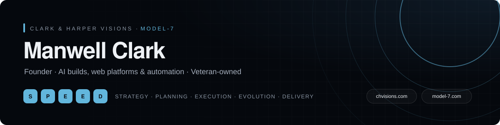

  

  
  
  

### 👋 Hi, I'm Clark

Founder of **[Clark & Harper Visions](https://chvisions.com)** — a full-service digital solutions company — and **[Model-7](https://model-7.com)**, our AI consulting, custom-build and automation division. U.S. military veteran with 20+ years across defense, Air Force program management and enterprise IT, now building AI products, web platforms and veteran-focused tools.

Every project runs on **S.P.E.E.D.** — **S**trategy · **P**lanning · **E**xecution · **E**volution · **D**elivery.

### 🛠️ What I build

| | |
|---|---|
| **AI products** | Voice receptionists, business chat assistants, veteran-benefits AI, a home-grown LLM behind an OpenAI-compatible API |
| **Web platforms** | Next.js sites, admin dashboards, CRMs and client portals |
| **Automation & ops** | Self-hosted deploys on Coolify, AI-assisted business operations |

### 🧰 Stack

  
  
  
  
  
  
  

### 🎖️ Certifications

  
  
  
  
  
  
  

---

Leander, TX · Greater Austin · <a href="https://chvisions.com">chvisions.com</a> · <a href="https://model-7.com">model-7.com</a>

