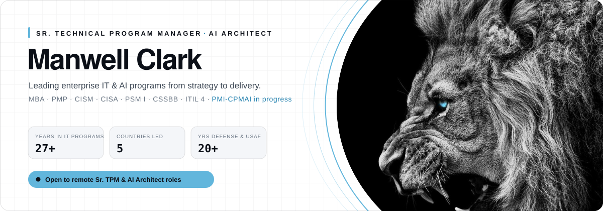

<picture>
  <source media="(prefers-color-scheme: dark)" srcset="./banner-dark.svg">
  
</picture>

  

### Hi, I'm Clark 👋

I'm a **Senior Technical Program Manager and AI Architect** with **27 years in IT program and project management**. I've delivered enterprise IT and mission systems across the defense sector and U.S. Air Force, and I've led **remote teams across five countries**. I also design and ship AI products end to end: voice agents, LLM-backed assistants and the platforms that run them.

I'm a U.S. military veteran. I founded **[Clark & Harper Visions](https://chvisions.com)** and its AI division **[Model-7](https://model-7.com)**, and I run every engagement on my **S.P.E.E.D.** framework: **S**trategy · **P**lanning · **E**xecution · **E**volution · **D**elivery.

### What I bring

| | |
|---|---|
| **Program leadership** | Multi-team, multi-country delivery in Agile, Waterfall and hybrid models. Portfolio governance, budgets, risk and stakeholder alignment from executive level down to engineering. |
| **AI architecture** | LLM application design (RAG, agents, voice AI), self-hosted model serving behind OpenAI-compatible APIs, and AI governance and adoption planning. |
| **Security & governance** | CISM / CISA-grounded risk management, compliance and controls built into delivery instead of bolted on afterward. |
| **Platform delivery** | Next.js / TypeScript products, containerized deploys on Docker and Coolify, and zero-trust networking with Tailscale. |

### Selected builds

- **D.I.A.R.A.**: voice AI that powers virtual receptionists for small businesses
- **MYKAEL**: AI brand-identity and prompt studio
- **CHV Command**: an operations dashboard built around S.P.E.E.D., with Agile, Waterfall and hybrid project views
- **Model-7 LLM**: an in-house model served through an OpenAI-compatible API to power SaaS tools

### Certifications

  
  
  
  
  
  
  
  

### Stack

  
  
  
  
  
  

---

Greater Austin, TX · Remote · <a href="https://chvisions.com">chvisions.com</a> · <a href="https://model-7.com">model-7.com</a>

