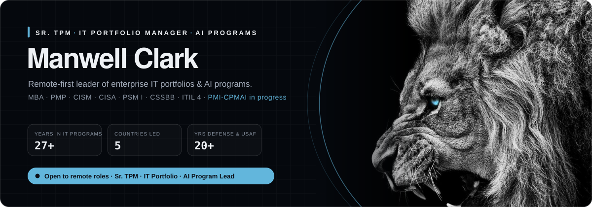

◐ <b>Switch view</b>: see the dark version

 

  
  

### Hi, I'm Clark 👋

I'm a **Senior Technical Program Manager** and **IT Portfolio Manager** with **27 years in IT program and project management**, and I now lead and build **AI programs**. I've delivered enterprise IT and mission systems across the defense sector and the U.S. Air Force, and I've led **remote teams across five countries**.

**Target roles:** Sr. Technical Program Manager · IT Portfolio Manager · Sr. Manager, IT Portfolio / PMO · AI Program Manager · AI Architect

### What I bring

| | |
|---|---|
| **Program & portfolio leadership** | Running multi-team, multi-country programs in Agile, Waterfall and hybrid models. Portfolio intake and prioritization, roadmaps, budget and resource planning, risk and dependency management, executive reporting. |
| **AI programs & architecture** | Taking AI from use case to production: LLM applications (RAG, agents, voice AI), self-hosted model serving behind OpenAI-compatible APIs, AI governance and adoption planning. Currently earning the PMI-CPMAI. |
| **Security & governance** | Risk, compliance and controls grounded in CISM and CISA, built into delivery from the start. |
| **Remote execution** | Async-first operating rhythm, clear written status, and distributed teams aligned across time zones without losing delivery pace. |

### How I run programs: S.P.E.E.D.

**S**trategy → **P**lanning → **E**xecution → **E**volution → **D**elivery. It's my delivery framework for portfolios and AI initiatives. It ties every project to a business outcome, gates each phase, and keeps improving after launch.

### Proof of work

I also founded **[Clark & Harper Visions](https://chvisions.com)** and its AI division **[Model-7](https://model-7.com)**, where I plan, architect and ship real products:

- **CHV Command**: a portfolio and operations dashboard with S.P.E.E.D., Agile, Waterfall and hybrid views, Gantt timelines, and payment and duration tracking
- **D.I.A.R.A.**: voice AI that powers virtual receptionists for small businesses
- **Model-7 LLM**: an in-house model served through an OpenAI-compatible API to power SaaS tools
- **KidsBookForge**: a subscription SaaS for creating and publishing books on Amazon KDP

### Certifications

  
  
  
  
  
  
  
  

### Tools & stack

  
  
  
  
  
  

---

U.S. military veteran · Greater Austin, TX · Open to remote roles · <a href="https://chvisions.com">chvisions.com</a> · <a href="https://model-7.com">model-7.com</a>

